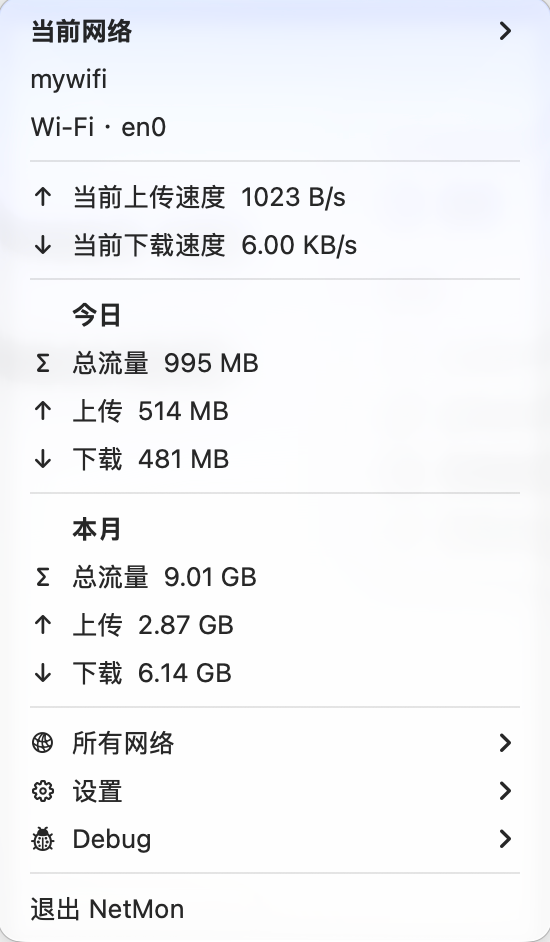

# NetMon

**中文** | [English](README_en.md)


NetMon 是纯本地的 macOS 菜单栏流量统计工具。菜单栏显示实时上传、下载速度与当前网络今日总流量；展开菜单可查看各网络的用量历史。Wi-Fi 按名称（SSID）分别统计，也支持 Ethernet、PPP/PPPoE、VPN 和其他主网络接口。

支持 **macOS 14+、Apple Silicon / arm64**，提供**中文和 English** 界面。当前公开版本为 **v0.1.1 预览版**，使用 ad-hoc 签名，未经过 Apple 公证。

## 下载与安装

直接下载当前版本：

| 文件 | 用途 |
| --- | --- |
| [NetMon-0.1.1-arm64.dmg](https://github.com/TastelessFirework/NetMon/releases/download/v0.1.1/NetMon-0.1.1-arm64.dmg) | 打开镜像，将 NetMon 拖入 Applications |
| [NetMon-0.1.1-arm64.zip](https://github.com/TastelessFirework/NetMon/releases/download/v0.1.1/NetMon-0.1.1-arm64.zip) | 解压后将完整应用包放到“应用程序” |
| [SHA256SUMS](https://github.com/TastelessFirework/NetMon/releases/download/v0.1.1/SHA256SUMS) | DMG 与 ZIP 的 SHA-256 校验值 |

版本详情见 [v0.1.1 Release](https://github.com/TastelessFirework/NetMon/releases/tag/v0.1.1)。

DMG 中的 NetMon 与 Applications 两个图标左右并排。应用可安装到 `/Applications` 或 `~/Applications`，许可证包含在应用包内。

首次打开若被 macOS 阻止，先尝试打开应用，再按系统提示到“系统设置 → 隐私与安全性”选择“仍要打开”，随后确认“打开”。受管理的 Mac 可能不允许放行，具体见 [Apple 打开未公证应用说明](https://support.apple.com/zh-cn/102445)。

首次启动会请求位置权限，用于读取 Wi-Fi SSID，不读取或保存经纬度。拒绝授权时，无法识别名称的 Wi-Fi 暂停统计。**登录时启动默认关闭**，可在设置中主动开启。

## 界面与功能

### 菜单栏


左侧两行分别显示实时上传和下载速度；右侧上方显示自定义网络名称（未命名时为 `usage`），下方显示当前网络今日总流量。

### 流量明细



截图中的网速和用量仅反映拍摄时的状态。

- **当前网络**：查看网络名称、类型和接口；通过子菜单打开系统网络设置，或调整 macOS 网络服务顺序。修改顺序需要管理员认证。
- **实时网速**：上传和下载分别显示，菜单展开期间持续更新。
- **今日 / 本月**：查看当前网络的总量、上传和下载。
- **所有网络**：查看各网络与全部网络合计的今日、最近 7 天、本月和全部历史用量。
- **设置**：选择界面语言，管理统计开关、自定义网络名称、登录时启动、SSID 权限和历史数据。
- **Debug**：查看接口计数器与采样状态，按需启用文件日志。

### 界面语言

在“设置 / Settings”二级菜单顶部选择 **中文** 或 **English**。两种语言各占一行，当前语言左侧打勾。默认中文，选择会保存；切换后重新打开菜单即可生效，无需重启。

菜单、用量明细、应用对话框、错误提示、辅助功能文字与历史日期使用所选语言。SSID、自定义网络名称和系统网络服务名称保持原文；macOS 权限、认证和系统设置窗口跟随系统语言。

### 自定义网络名称

Wi-Fi、Ethernet 和 PPP/PPPoE 可设置最多 6 个字符的名称，留空恢复默认名称。自定义名称用于菜单与菜单栏展示，不更改 Wi-Fi SSID 或系统网络服务名称。

## 流量统计方式与限制

NetMon 每秒读取主接口的 64 位字节计数器，分别累计上传和下载，通常每 10 秒将数据批量写入本地 SQLite 数据库。

- 只统计应用运行期间的主接口流量，不补记应用关闭期间的用量，也不统计所有接口的并行流量。
- Wi-Fi 按 SSID 分组。同名 SSID 会合并，即使来自不同地点或 AP；不按 BSSID 区分。Ethernet、PPP 等主要按类型和接口身份分组。
- 只有采样区间两端网络身份与接口一致、计数器未回退且间隔不超过 15 秒时，才计入差值。网络切换、断线、睡眠、设置变化或计数器回退会重建采样基线。切换边界可能少记；公开 API 无法原子读取 SSID 与计数器。
- VPN 优先统计推断的底层 Wi-Fi/Ethernet 接口，包含隧道开销；多接口、分流 VPN 和 IPv4/IPv6 使用不同路径时可能无法准确选择底层接口。
- 按本地日期汇总，跨午夜采样区间计入结束日。异常退出可能丢失约 10 秒未落盘数据。
- 接口流量包含协议开销，不是逐应用统计或运营商计费账单。
- 修改网络服务顺序会影响整个 Mac。提交后若应用或回读失败，配置可能已经改变，失败提示不保证回滚。
- 数据库无法初始化时应用会退出；磁盘满、数据库损坏和极端整数边界的恢复体验仍待完善。

## 权限与隐私

所有数据保存在本机。应用不上传数据，不含账号、广告、Telemetry、测速或自动更新服务。

| 行为 | 权限及数据 |
| --- | --- |
| 读取 Wi-Fi SSID | CoreWLAN 与 Core Location 授权；只请求授权，不启动位置更新，不读取或保存经纬度 |
| 读取流量 | Darwin `NET_RT_IFLIST2` 的 64 位接口计数器，无逐包捕获 |
| 修改网络服务顺序 | Security Authorization 与 SystemConfiguration；每次真实修改创建授权，结束后销毁，不缓存管理员密码 |
| 登录时启动 | `SMAppService.mainApp`；默认关闭，用户主动开启才注册 |
| Debug | 菜单显示真实网络信息；系统日志消息标为 private，可选文件日志为明文 |

本地数据位置：

```text
~/Library/Application Support/SSIDTrafficMonitor/usage.sqlite3
~/Library/Logs/SSIDTrafficMonitor/debug.log
```

数据库包含 SSID、自定义网络名称、接口、使用时间和字节总量，未加密。Debug 文件日志默认关闭，启用后包含 SSID、接口、时间戳与采样差值，没有日志轮转；关闭日志不会删除已有文件。数据库、日志和未脱敏的 Debug 截图不应提交到 GitHub。

## 更新与卸载

更新前从菜单退出 NetMon，再替换完整应用包并重新打开。更新会保留本地历史数据、应用设置与系统登录项选择。

卸载时先关闭登录时启动并退出应用，再将应用包移到废纸篓。若需删除历史与日志，可在 Finder 中移除上述数据文件所在的两个目录。设置中的“清除历史数据”同时删除自定义名称，不可撤销。

## 从源码构建

需要 Apple Command Line Tools 或完整 Xcode，以及 **Swift 6 或更新版本**。测试使用 Swift Testing；Swift Package manifest 的 tools-version 为 5.10。项目无第三方 SwiftPM 依赖。

在项目目录运行：

```bash
make test      # 运行自动测试
make app       # Release 构建，生成 ad-hoc 签名的 dist/NetMon.app
make package   # 生成 DMG、ZIP 与 SHA256SUMS，不安装或发布
```

其他入口包括 `make build`（Debug）、`make release`（Release 可执行文件）、`make icon`（重新生成 ICNS）和 `make install`（构建并复制到当前用户的 Applications 目录，可用 `INSTALL_DIR` 覆盖）。安装后可手动运行：

```bash
open ~/Applications/NetMon.app
```

应用需安装到 `/Applications` 或 `~/Applications` 才能注册登录项。图标源图为 `Resources/AppIcon.png`，应用打包使用 `Resources/AppIcon.icns`；修改源图后先运行 `make icon`。

脚本默认使用 `xcrun` 选择的 SDK；当默认为 Command Line Tools 的 macOS 27.0 SDK 且 26.5 SDK 可用时，选择兼容 SDK。可显式指定：

```bash
SSID_TRAFFIC_SDK=/path/to/MacOSX.sdk make app
```

构建使用项目内的 module cache 与 SwiftPM `--disable-sandbox` 参数。应用没有 App Sandbox entitlement。编译输出使用主机原生架构，不自动生成 Universal 二进制；发布打包要求 arm64，不提供 Intel 安装包。

## 测试与项目结构

31 项自动测试覆盖流量归属边界、SQLite 持久化与聚合、自定义命名、网络服务排序、用量汇总、语言偏好与翻译格式、Darwin 计数器读取。真实网络、菜单悬停、权限、登录项与语言切换验收步骤见 [TESTING.md](TESTING.md)。完整实机功能矩阵与 macOS 14 最低支持系统兼容性仍待验收，自动测试不能替代实机验证。

| 路径 | 职责 |
| --- | --- |
| `Sources/CNetworkStats` | Darwin 64 位接口计数器 C 封装 |
| `Sources/NetMonCore` | 流量归属、SQLite、汇总、服务排序与语言支持 |
| `Sources/NetMon` | AppKit 菜单、网络解析、授权、登录项与采样调度 |
| `Resources` | 应用图标、版本信息、双语权限说明与 DMG 布局 |
| `Scripts/build.sh` | 测试、编译与应用打包 |
| `Scripts/package.sh` | arm64 校验、DMG/ZIP 分发包与 SHA-256 校验文件 |

## 许可证

[MIT](LICENSE)，版权署名为 `Copyright (c) 2026 Eric`。应用包内包含许可证副本。
